# Luma Hive

**Um workspace local para transformar uma ideia em entregas com uma squad de agentes de IA — do briefing à revisão humana.**

Luma Hive reúne projetos, agentes especializados, documentos, sprints, conversas e execuções em uma única interface. Você define a demanda, acompanha quem está trabalhando, responde às dúvidas e aprova as entregas. Os agentes usam os CLIs instalados na sua máquina; o histórico fica em SQLite local.

**Angular 20 · TypeScript · Node.js · SQLite · Codex / Devin / Antigravity**

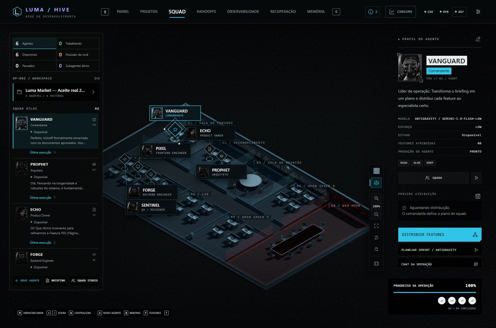

[Começar](#baixar-e-rodar) · [Configurar os agentes](#conectar-os-clis-e-configurar-os-agentes) · [Jornada com prints](#uma-jornada-pelo-luma-hive) · [Temas e idiomas](#interface-mapas-e-retratos-independentes) · [Documentação](#documentação-e-próximos-passos)

## Por que este projeto existe

O Luma Hive nasceu da evolução de uma base local do [Squad Code Network](https://github.com/felipeAguiarCode/squad-code-network), de Felipe Aguiar. A proposta inicial foi migrar a aplicação de JavaScript puro para **Angular 20**, preservando a experiência visual e os fluxos existentes, com componentes, contratos e serviços mais organizados.

A partir dessa base, o projeto ganhou recursos para lidar com o trabalho real de uma squad: identificar bloqueios, acompanhar chamadas a subagentes, inspecionar ferramentas e consumo, pausar e recuperar etapas, revisar entregas e guardar decisões e lições do projeto. A intenção é tornar o processo compreensível para quem solicita o trabalho, além de oferecer uma visualização dos agentes.

O frontend, os serviços e a organização do backend foram reimplementados em TypeScript. Recursos visuais, conteúdo do catálogo e algoritmos visuais portados mantêm a atribuição da origem em [THIRD_PARTY_NOTICES.md](THIRD_PARTY_NOTICES.md). A aplicação Angular não carrega o `app.js` antigo.

## Para que usar

- **Organizar uma demanda:** briefing, visão, escopo, glossário, arquitetura, ADRs, sprints e features vinculados ao projeto.
- **Montar uma squad:** comandante, produto, arquitetura e operadores de frontend, backend, QA, documentação e outras especialidades; configurar identidade, instruções, modelo e ferramentas.
- **Executar com acompanhamento:** aprovar o plano, conversar com o time, acompanhar as etapas e pausar ou retomar a operação.
- **Entender o que aconteceu:** consultar execuções, eventos, erros, ferramentas e subagentes quando o CLI oferece esses dados.
- **Revisar e aprender:** aprovar entregas, consultar checkpoints e transformar decisões e aprendizados em memória aprovada para próximas chamadas.
- **Experimentar o fluxo sem inferência:** usar o modo Demonstração antes de conectar um provedor real.

É uma aplicação **local em desenvolvimento**, adequada para experimentação e acompanhamento de projetos na própria máquina. Não oferece autenticação multiusuário nem um serviço hospedado. Os arquivos das operações são escritos pelos CLIs, conforme as permissões do provedor e de cada agente.

## Baixar e rodar

### Requisitos

| Componente | O que instalar                                                                     |
| ---------- | ---------------------------------------------------------------------------------- |
| Node.js    | **24.x recomendado**, ou **22.12+ na linha 22**, com npm                           |
| Git        | Disponível no terminal; usado pelo repositório e pelas pastas das operações        |
| Navegador  | Navegador moderno; a validação de interface foi feita com Microsoft Edge           |
| CLI de IA  | Opcional para demonstração; instalar e autenticar pelo menos um para execução real |

O ambiente de referência é Windows/PowerShell. Em outros terminais, use `npm` no lugar de `npm.cmd`. Não é preciso instalar Angular CLI global, Docker ou um serviço de banco separado.

### Instalação

```powershell
git clone https://github.com/Guirilima/luma-hive.git
cd luma-hive
npm.cmd ci
npm.cmd start
```

Abra **http://127.0.0.1:4318** e encerre com **Ctrl+C** no terminal.

Para experimentar a branch desta entrega antes de sua integração à `main`, clone com:

```powershell
git clone --branch codex/feature/agent-observability https://github.com/Guirilima/luma-hive.git
```

O `start` compila Angular e API antes de servir os dois juntos, evitando usar um build antigo. Use `npm.cmd` no PowerShell quando a política de execução bloquear `npm.ps1`; não é necessário alterar essa política.

### Primeiro acesso

1. Escolha **criar uma operação**, **carregar o exemplo Atlas Commerce** ou **importar um backup**.
2. Para conhecer a interface, use **Configurações → Execução → Demonstração**. Uma operação criada do zero começa nesse modo; confira a configuração ao carregar exemplos ou backups.
3. Escolha uma squad e preencha o contexto do projeto. O SQLite é criado em `data/luma.db` após a criação/importação do workspace.
4. Para gerar arquivos e resultados reais, configure um CLI e mude para execução real conforme a próxima seção.

**Demonstração é simulação identificada:** ela não comprova código escrito, testes executados ou consumo real de LLM. O histórico do piloto Luma Market mostrado nos prints não acompanha uma instalação nova; o exemplo inicial é Atlas Commerce.

## Conectar os CLIs e configurar os agentes

O Luma não fornece uma conta, assinatura ou créditos de IA. Ele chama o executável instalado e autenticado no seu ambiente. Você pode conectar um ou mais provedores, e cada agente pode usar uma configuração própria.

| Conector    | Executável esperado | Integração da aplicação                                          |
| ----------- | ------------------- | ---------------------------------------------------------------- |
| Codex       | `codex`             | Execução estruturada e consulta de modelos pelo adaptador do CLI |
| Devin       | `devin`             | Execução por prompt e catálogo suportado pelo CLI instalado      |
| Antigravity | `agy`               | Entrada/saída estruturada, modelos e perfis de agentes           |

1. **Instale e autentique o CLI escolhido pelo procedimento do próprio provedor.** Confirme no terminal que o executável abre. Login no GitHub ou em um plugin não autentica esses CLIs.
2. Em **Configurações**, abra a aba do provedor. Confira a detecção ou informe o caminho absoluto do executável se ele não estiver no `PATH`. Use as ações de conexão/modelos da tela.
3. Escolha o modelo e esforço entre os disponibilizados pelo CLI. Não há uma lista universal de modelos ou preços; disponibilidade depende da versão e da conta.
4. Em **Execução**, selecione execução real e ajuste timeout, intervalo e concorrência conforme sua demanda.
5. Em **Permissões e autonomia**, confira a política do provedor. No **Estúdio do agente**, configure somente as ferramentas necessárias ao papel. Um agente de leitura não recebe terminal/escrita só por participar da squad.
6. Salve, preencha os documentos do projeto e **revise o plano antes de aprovar sua execução**. Ao terminar a rota, a feature ainda passa por revisão humana.

O header mostra os **CLIs detectados**, com nome completo quando há apenas um e identificação compacta quando há vários. Clique para abrir a configuração correspondente. Detecção do executável não comprova autenticação, cota ou autorização para executar determinada ferramenta.

As permissões do perfil, as confirmações nativas do CLI e o isolamento do sistema operacional são coisas diferentes. As opções avançadas e seus limites estão em [Permissões e autonomia](docs/PERMISSOES.md); aprovar uma política do CLI não elimina o aceite humano do plano ou da entrega.

<details>
<summary><strong>Ver configurações de aparência e permissões dos agentes</strong></summary>

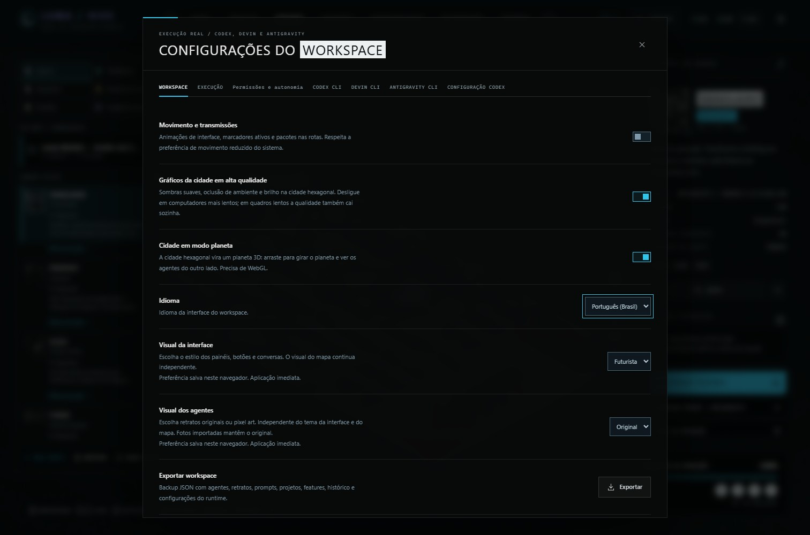

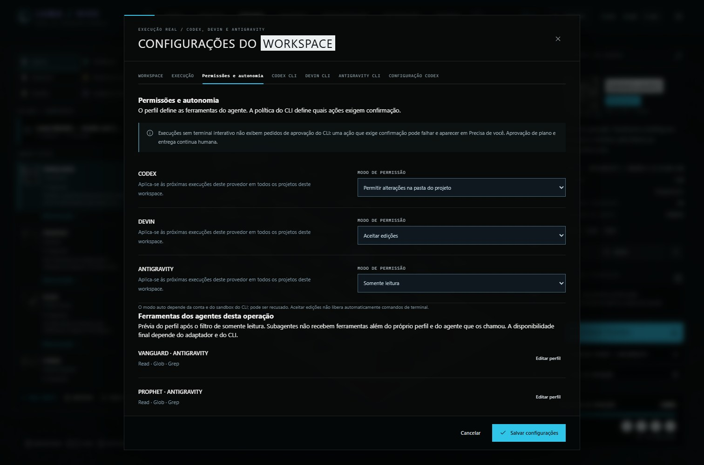

</details>

## Uma jornada pelo Luma Hive

As capturas abaixo mostram a interface atual com uma **cópia isolada do workspace do aceite real**. O projeto Luma Market foi um website de três telas: login demonstrativo, carrossel de produtos e contato/sobre. As telas foram fotografadas com Playwright, sem novas inferências; caminhos pessoais foram anonimizados. Não são mockups. Veja a [origem das capturas](docs/images/README.md) e o [relatório do aceite](docs/ACEITE-REAL-2026-10-25.md).

### 1. Escolher e organizar os projetos

O painel resume operações, andamento e entregas. Busca, situação, squad e ordenação ajudam a reencontrar projetos. **Ativo** indica a operação selecionada; **Concluída** indica a conclusão das entregas, sem depender apenas da porcentagem.

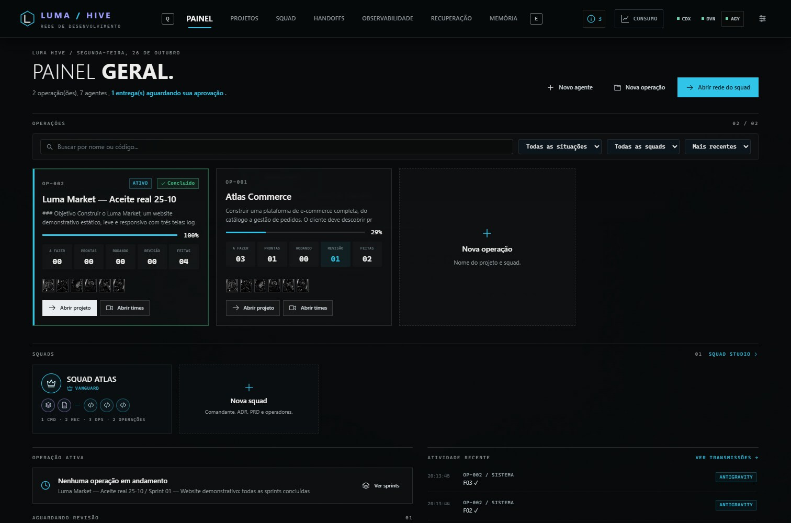

### 2. Construir o contexto com a equipe

Na página Projetos, organize o briefing e os documentos. **Agent Teams** reúne comandante, produto e arquitetura para conversar, esclarecer decisões e propor alterações nos documentos. O conteúdo pode ser revisado e salvo no projeto.

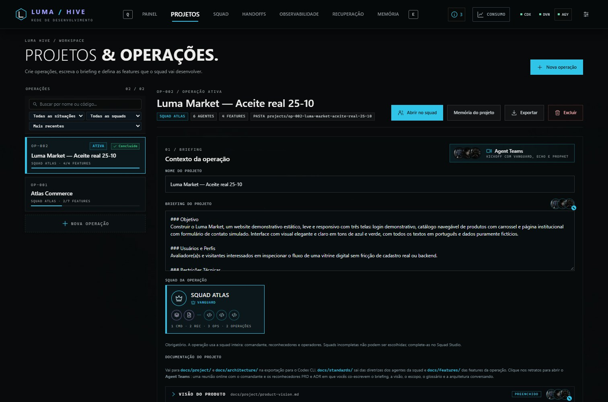

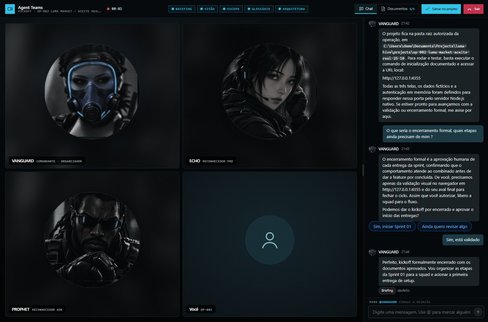

### 3. Planejar a sprint, acompanhar e revisar

Crie a sprint e as demandas com critérios e dependências. A squad propõe a rota; você aprova o plano e acompanha as etapas. **Pausar** aguarda a etapa em andamento antes de impedir a próxima. Ao terminar, valide os resultados e aprove cada entrega; uma resposta do agente não é aprovação automática.

A seção **Executar e validar** guarda orientações manuais do projeto. Sprints concluídas também podem ter um rascunho de guia consultável e exportável. A geração automática pelo documentador e o histórico completo desses guias ainda estão no backlog.

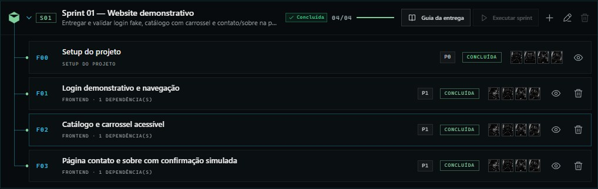

### 4. Investigar ferramentas, subagentes e consumo

Em **Observabilidade**, selecione uma execução para inspecionar agente responsável, consultas a auxiliares, eventos, ferramentas, resultados e falhas. Quando o conector não informa detalhes internos ou tokens de um subagente, a interface sinaliza a limitação.

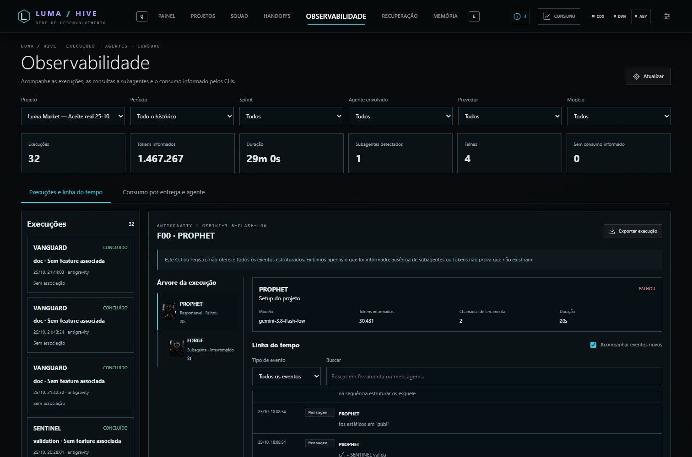

O botão **Consumo** do header abre uma prévia e um painel detalhado. A observabilidade permite agrupar o uso por agente, entrega, sprint, modelo e provedor. **Consumo local é diferente de saldo da conta**; cache não é somado novamente, e valores ausentes não viram zero. Cota mensal e preço só podem ser mostrados quando há dados verificáveis. Mais detalhes em [Consumo e cotas](docs/CONSUMO-E-COTAS.md).

<details>
<summary><strong>Ver consumo agrupado por entrega e agente</strong></summary>

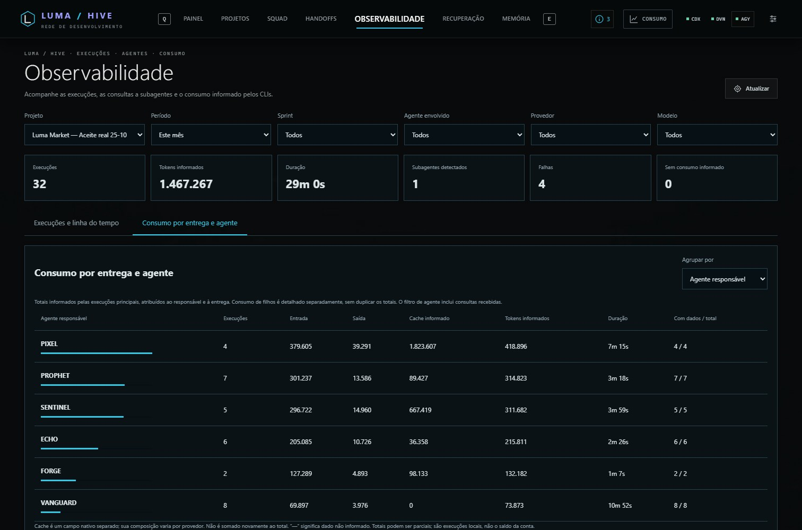

</details>

### 5. Recuperar o trabalho e guardar os aprendizados

Em modo real, o servidor coordena a sprint mesmo se a aba fechar. O processo Node e o CLI precisam continuar ligados. Após reiniciar o servidor, uma etapa sem confirmação fica **incerta**, exigindo revisão antes de repetir; não há rollback automático dos arquivos alterados.

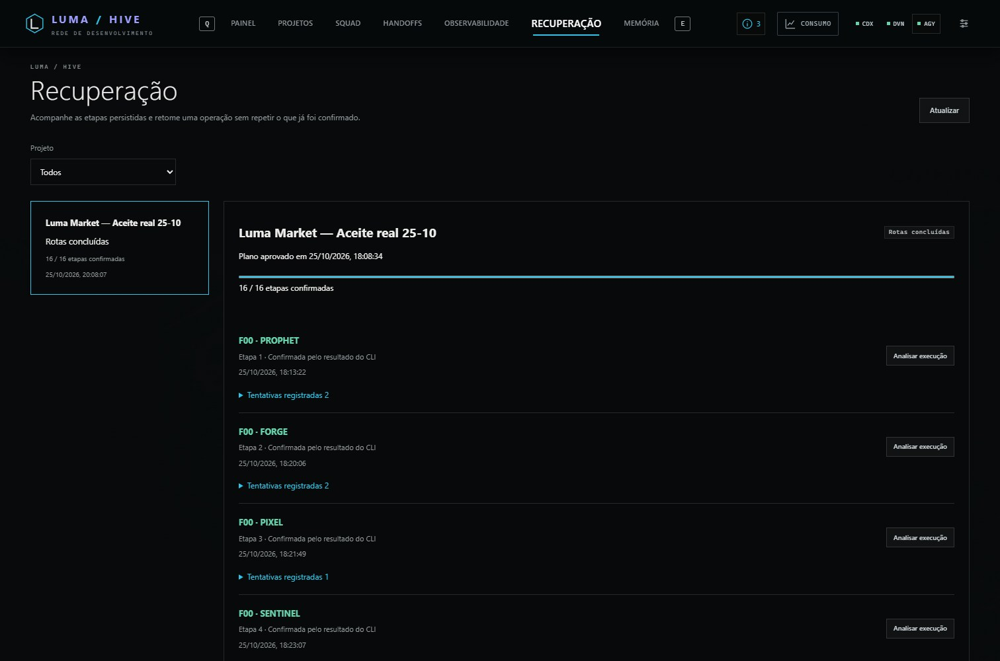

Na **Memória**, registre decisões, restrições e lições com sua origem. **Somente registros aprovados** entram no contexto de chamadas futuras. Editar retira a aprovação; arquivar preserva o histórico e remove o registro do contexto ativo.

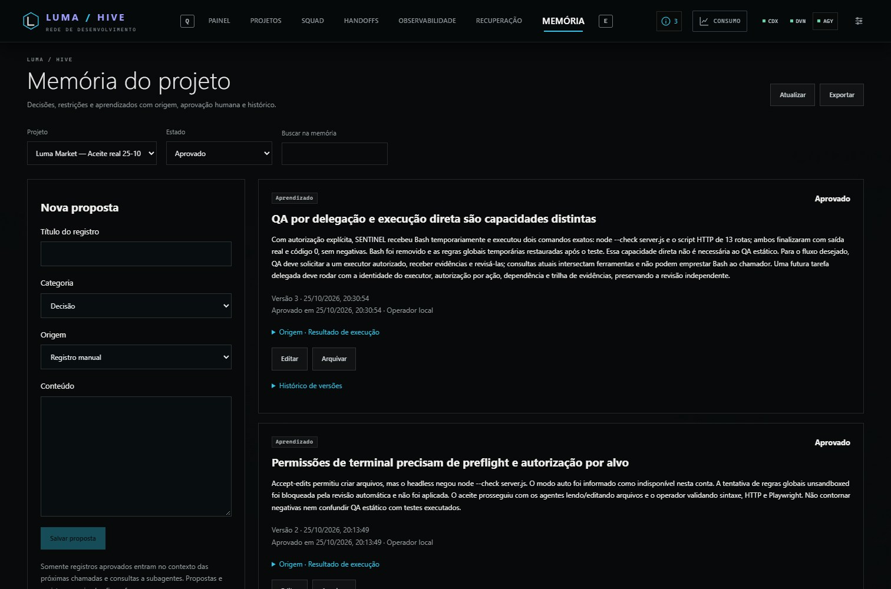

## Interface, mapas e retratos independentes

Você pode combinar as preferências sem mudar o projeto ou a lógica de execução:

| Preferência         | Onde escolher             | Opções                                      |
| ------------------- | ------------------------- | ------------------------------------------- |
| Idioma              | Configurações → Workspace | Português, inglês e espanhol                |
| Visual da interface | Configurações → Workspace | Futurista ou Pixel art                      |
| Visual dos agentes  | Configurações → Workspace | Retratos originais ou Pixel art             |
| Mapa                | Controles da aba Squad    | Escritório 3D, escritório pixel e cidade 3D |

A aparência da interface e dos retratos fica no navegador; idioma e mapa pertencem ao workspace. Trocar o idioma da tela não traduz o conteúdo já escrito nem dispara uma chamada para reescrever documentos. Animações de circulação são uma representação visual; os estados vêm das execuções ou da demonstração identificada.

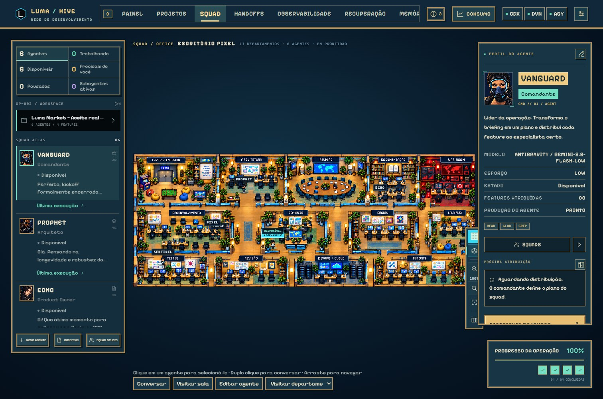

<details>
<summary><strong>Ver a visualização no celular</strong></summary>

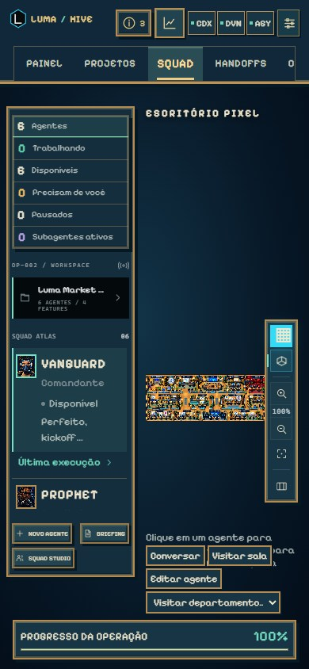

</details>

## Desenvolvimento e configuração local

```powershell
npm.cmd run dev
```

No desenvolvimento, abra **http://127.0.0.1:4200**: Angular com atualização automática e proxy para a API em **4318**. O modo normal (`npm.cmd start`) serve tudo em **4318**. Se alterar a porta da API no desenvolvimento, ajuste também `apps/web/proxy.json`.

A aplicação lê variáveis do ambiente do processo. **O start não carrega `.env` automaticamente**; `.env.example` é uma referência. Exemplo no PowerShell:

```powershell
$env:LUMA_PORT = "4320"
npm.cmd start
# Abra http://127.0.0.1:4320
```

| Variável               | Padrão / finalidade                                                 |
| ---------------------- | ------------------------------------------------------------------- |
| `LUMA_PORT`            | `4318` — porta HTTP; servidor ligado a `127.0.0.1`                  |
| `LUMA_DATA_DIR`        | `data/` — diretório do SQLite                                       |
| `LUMA_PROJECTS_DIR`    | `projects/` — diretório das pastas de trabalho                      |
| `LUMA_ROOT`            | Diretório atual — raiz usada para resolver os recursos da aplicação |
| `LUMA_CODEX_BIN`       | Caminho alternativo do executável Codex                             |
| `LUMA_DEVIN_BIN`       | Caminho alternativo do executável Devin                             |
| `LUMA_ANTIGRAVITY_BIN` | Caminho alternativo do executável Antigravity                       |

Para uso comum, configure os executáveis pela interface. As diferenças entre CLIs ficam em adaptadores separados; não é preciso fornecer parâmetros de um provedor a outro.

### Comandos do repositório

| Comando                    | Uso                                                      |
| -------------------------- | -------------------------------------------------------- |
| `npm.cmd ci`               | Instalar as dependências fixadas no lockfile             |
| `npm.cmd start`            | Compilar e iniciar frontend + API                        |
| `npm.cmd run dev`          | Desenvolvimento com atualização automática               |
| `npm.cmd run build`        | Compilar Angular e API                                   |
| `npm.cmd run typecheck`    | Conferir tipos sem emitir o build                        |
| `npm.cmd run format:check` | Conferir formatação                                      |
| `npm.cmd test`             | Suíte unitária disponível para a etapa própria de testes |
| `npm.cmd run test:ui`      | Smoke de interface com dados/CLIs isolados               |

A revisão documentada de 26/10 verificou build e cenários de navegador nos três idiomas e dois temas, incluindo mobile. **Os testes unitários não foram executados ou alterados nessa rodada.** Não se afirma cobertura de 100% dos fluxos legados ou de todas as combinações de provedores. Avisos e pendências estão no [relatório de aceite e backlog](docs/ACEITE-REAL-2026-10-25.md).

### Estrutura

```text
apps/web/src/app/
  core/          Estado, API, idiomas, aparência, execução e workflow
  features/      Projetos, agentes, squads, mapas, conversas e monitoramento
  shared/        Componentes e utilitários reutilizáveis
apps/web/src/styles/   Tokens, temas e estilos das telas
apps/web/public/      Retratos, fontes e recursos visuais
apps/api/src/
  http/          API HTTP e sessão local
  providers/     Adaptadores dos CLIs
  runs/          Ciclo de vida e eventos das execuções
  workflow/      Coordenação, recuperação e memória
  storage/       Persistência em SQLite
packages/domain/src/  Contratos e regras compartilhadas
scripts/              Inicialização e desenvolvimento
docs/                 Guias, arquitetura, aceite e imagens
```

Novos textos de interface devem usar chaves em `apps/web/src/app/core/i18n/labels.ts`, nos três idiomas. Novas telas devem considerar os dois temas, teclado, mobile e estados de vazio/carregamento/erro.

## Dados, backup e limites atuais

- **Banco local:** `data/luma.db`, com arquivos auxiliares WAL/SHM durante o uso. Operações, execuções, eventos e memória ficam no SQLite; os arquivos produzidos ficam em `projects/`.
- **Pastas das operações:** cada projeto tem uma pasta e repositório Git local próprio. O harness não faz commits automáticos das entregas.
- **Backup completo:** encerre a aplicação antes de copiar `data/luma.db` e preserve `projects/` separadamente. O JSON tradicional de exportação do workspace não inclui todas as tabelas de operações, memória e eventos; a memória tem exportação própria.
- **Segredos e contas:** autenticação permanece nos CLIs. Não coloque credenciais reais nos briefings, guias ou screenshots publicados.
- **Trabalho em andamento:** broker de tarefas delegadas entre perfis, preflight completo de permissões, documentação automática e histórico de versões dos guias ainda têm pendências. A árvore de subagentes não garante telemetria que o provedor não emite.

`node_modules/`, `dist/`, `.angular/`, `data/`, `projects/`, `previews/` e `.env` ficam fora do Git. As imagens em `docs/images/` são versionadas para que este README funcione no GitHub e em outro checkout.

## Documentação e próximos passos

| Guia                                                                              | Conteúdo                                                      |
| --------------------------------------------------------------------------------- | ------------------------------------------------------------- |
| [Arquitetura](docs/ARQUITETURA.md)                                                | Fronteiras entre Angular, Node, domínio e SQLite              |
| [Permissões e autonomia](docs/PERMISSOES.md)                                      | Perfis, políticas nativas dos CLIs e limitações               |
| [Workflow, recuperação e memória](docs/WORKFLOW.md)                               | Aprovações, checkpoints, retomada e contexto aprovado         |
| [Observabilidade](docs/OBSERVABILIDADE.md)                                        | Árvores, eventos, métricas e cobertura por provedor           |
| [Consumo e cotas](docs/CONSUMO-E-COTAS.md)                                        | Tokens locais e disponibilidade informada pelas contas        |
| [Tema pixel](docs/TEMA-PIXEL.md) e [idiomas/retratos](docs/IDIOMAS-E-RETRATOS.md) | Aparência e personalização                                    |
| [Migração](docs/MIGRACAO.md) e [paridade](docs/PARIDADE.md)                       | Histórico da reimplementação e conferências                   |
| [Aceite real e backlog priorizado](docs/ACEITE-REAL-2026-10-25.md)                | O que funcionou, falhas, evidências e TODOs MEL-001 em diante |
| [Origem dos recursos](THIRD_PARTY_NOTICES.md)                                     | Atribuições de código visual, catálogo, arte e fontes         |
